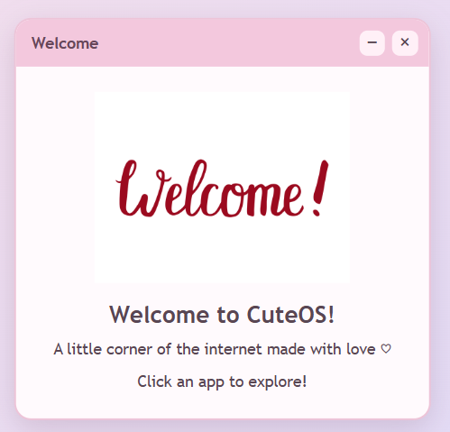
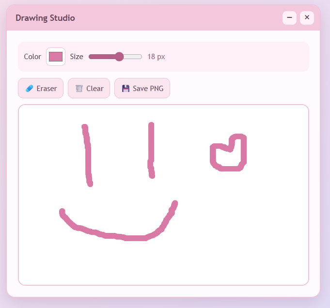
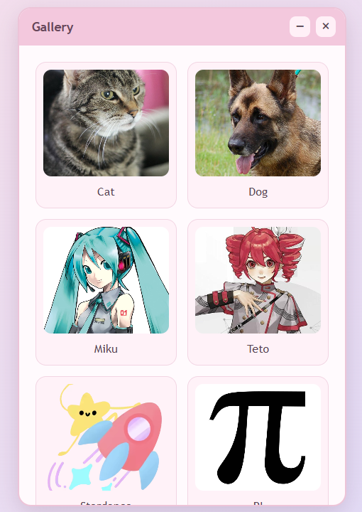

# CuteOS

This is my very own OS that runs in a web browser!

> [!NOTE]
> [Click here to check out CuteOS](https://heybochechinha.github.io/CuteOs/)

## About

CuteOS is a simple web-based operating system simulator. It simulates some apps and features of a real operating system.

**It has 3 apps**:

### 1. Welcome

A small window with a welcome message.

### 2. Drawing Studio

A simple drawing app where you can draw using different colors and brush sizes. You can also erase, clear, and download your drawing.

### 3. Photos

An app that displays pictures of cats and dogs.

